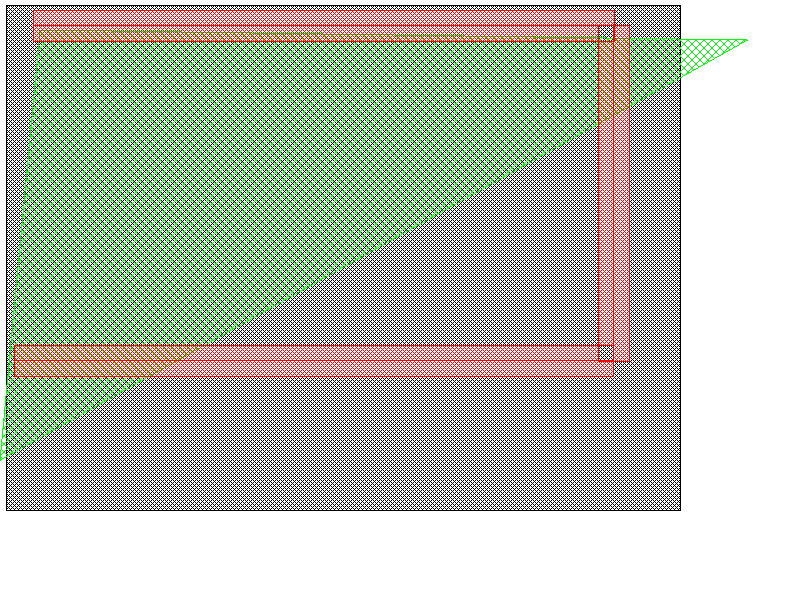
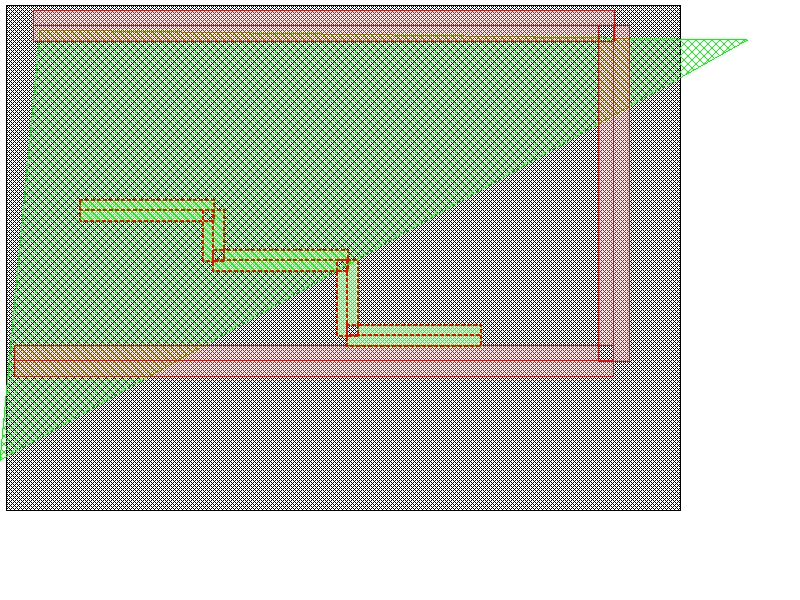
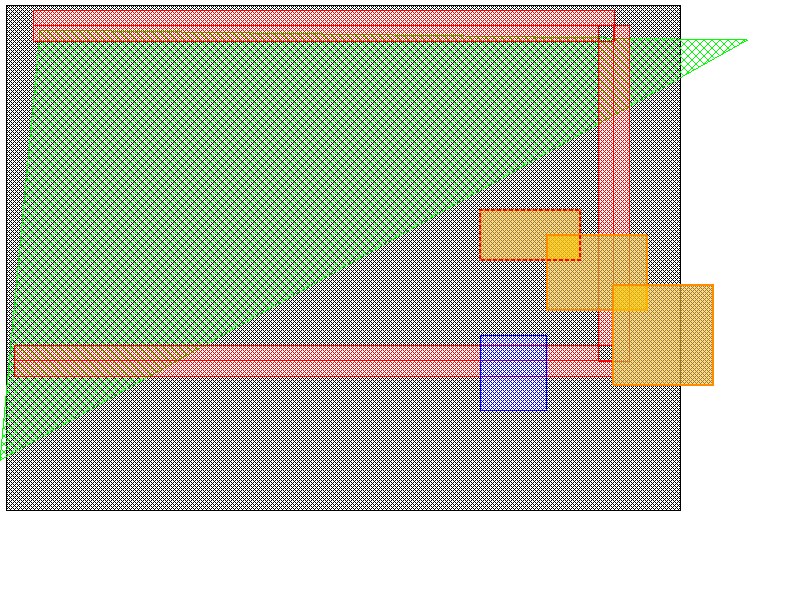
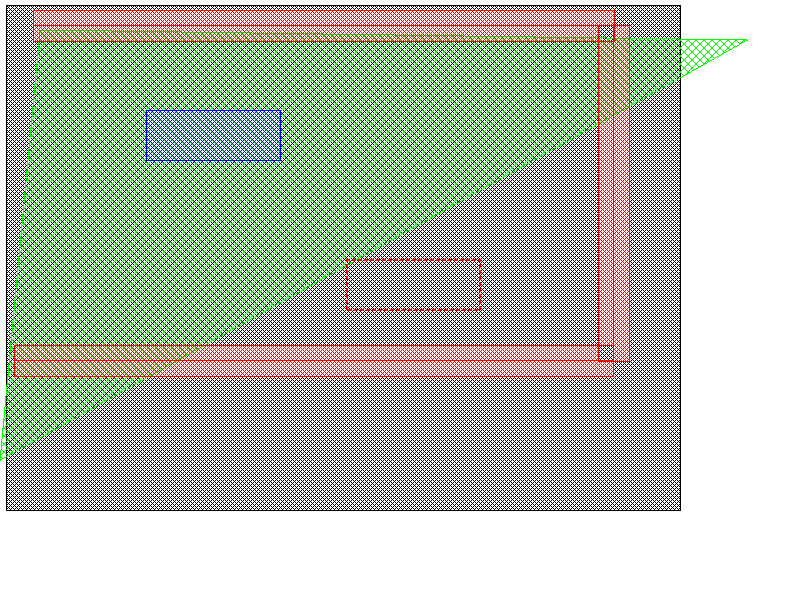

# Project 3：GDS 與 Qt Layout Viewer 報告

## Project Objective（專題目標）

本專題以老師提供的 `object_viewer`（以 Qt5 撰寫的 layout viewer）與 GitHub 上的 GDS parser 為基礎，理解 GDSII 檔案格式與 parser 的運作方式，並學習 Qt 事件驅動（event-driven）程式的架構：程式啟動後建立 event queue 等待事件，滑鼠點擊執行 query 時取得游標位置 (x, y)，找出其下的物件並在對話框中印出。

具體目標如下：

1. 找出程式中寫死（hard-coded）的圖形，新增兩個圖形，並追蹤圖形如何被加入、以哪個按鍵結束輸入。
2. 在視窗中進行數次 query 並截圖，找出負責 query 的函式。
3. 以程式 parse `two_stage.gds`（以 Synopsys 14nm university PDK 產生的兩級放大器 layout）。
4. 依題目中 Karl 的建議修改程式：將畫面存成圖檔、選取兩條以上的 path 合併成一條、追蹤同一 layer 上重疊的圖形（connectivity / color propagation）。

### 本專題的實作範圍

程式位於 `project3/object_viewer/`，由原始的 `project3/object_viewer_02102023/` 複製而來，資料夾結構與編譯方式皆與原始版本相同，可單獨編譯執行；原始資料夾保持不動，作為對照。`gdsFileParser/` 中的 parser 與測試檔未作修改。

1. **目標 1～3** 只需操作原程式與閱讀程式碼即可完成；新增的兩個圖形在視窗中以 R / B / P 畫出，寫死的圖形與原程式相同。
2. **目標 4** 需要修改程式，新增的功能為 Save Image（Ctrl+S）、Merge Paths（M）與 Connectivity（C）；為了方便操作，另外加入多選與輪流選取重疊圖形（Shift / Ctrl + 點選、N、Esc）、拖曳移動圖形與 Undo（Ctrl+Z）。
3. 其餘行為（啟動畫面、寫死的圖形、座標轉換、圖形繪製、Open GDS 時只印出 record 而不畫出）與原程式相同。

## 一、GDSII 格式與 object_viewer 程式解讀

GDSII 是 IC layout 常用的二進位交換格式，由一連串 record 組成。每個 record 開頭為 2 bytes 的總長度，接著 1 byte 的 record type 與 1 byte 的 data type，後面才是資料。一個 GDS 檔的整體階層如下：

```text
HEADER, BGNLIB, LIBNAME, UNITS
  BGNSTR, STRNAME            ← 一個 cell（structure）
    BOUNDARY / PATH / BOX     ← 圖形：LAYER, DATATYPE, (WIDTH, PATHTYPE), XY
    SREF                      ← 單一 instance：SNAME, (STRANS, MAG, ANGLE), XY
    AREF                      ← 陣列 instance：SNAME, COLROW, XY（3 點）
    TEXT                      ← 文字標籤
    ENDEL                     ← 每個 element 結束
  ENDSTR
ENDLIB
```

`UNITS` record 含兩個實數：第一個為每個 database unit 等於多少 user unit，第二個為每個 database unit 等於多少公尺。cell 之間以 SREF / AREF 互相引用，形成階層結構。

`gdsFileParser/` 中的 parser 採用 callback 設計。`gdsFileParser::parse()` 逐一讀取 record，依 record type 呼叫對應的 virtual function，例如 `onParsedBoundaryStart()`、`onParsedLayer()`、`onParsedXY()` 與 `onParsedEndElement()`。使用者只要繼承 `gdsFileParser` 並實作這些函式，就能建立自己的資料結構。`gdsFileParserMain.cpp` 中的 `MyTestParser` 是範例實作，每收到一個 record 就印出一行。

`object_viewer` 由以下類別組成：

| 類別 / 檔案 | 儲存內容 | 用途 |
| --- | --- | --- |
| `MainWindow`（`main_window.*`） | 選單、工具列、`Canvas` 指標 | 建立選單與快捷鍵，處理 Open、Query 與互動建立圖形 |
| `Canvas`（`canvas.*`） | 圖形集合 `_objects`、選取集合、`Transform` | 繪圖區 widget，負責繪製、滑鼠選取、鍵盤事件與 query |
| `ShapeObject`（`shape.*`） | 頂點 `_pts`、layer | 所有圖形的抽象基底類別 |
| `RectangleShape`、`BoundaryShape`、`PathShape` | 各自的幾何資料；`PathShape` 另存寬度與 end style | 實作 `draw()`、`drawSelected()`、`select()` |
| `Transform`（`transform.h`） | 可視範圍、X / Y 縮放比例 | 使用者座標與螢幕座標互換，處理 zoom 與 pan |

`main()` 建立 `QApplication` 與 `MainWindow` 後呼叫 `app.exec()`，進入 event loop。之後程式不再主動執行，而是由 Qt 把事件分派到對應的函式：

| 事件 | 處理函式 |
| --- | --- |
| 選單或快捷鍵觸發 | `QAction::triggered` signal 連到 `MainWindow` 的 slot，於 `createActions()` 中以 `connect` 建立 |
| 滑鼠按下 | `Canvas::mousePressEvent()` |
| 滑鼠移動 | `Canvas::mouseMoveEvent()` |
| 按鍵 | `Canvas::keyPressEvent()` |
| 需要重繪 | `Canvas::paintEvent()`；呼叫 `update()` 會把重繪事件排入佇列 |
| 視窗大小改變 | `Canvas::resizeEvent()` |

## 二、題目要求的項目

### 2.1 寫死的圖形與新增兩個圖形

寫死的圖形位於 `main_window.cpp` 的 `MainWindow::open()`。File → Open 選檔（或按 Cancel）後，程式先呼叫 `GdsFileParserMain()` 印出 GDS record，接著清空畫面、設定可視範圍，再加入三個寫死的圖形：

| 圖形 | 座標 | Layer |
| --- | --- | --- |
| 矩形 | (-1000, -1000) – (100000, 100000) | 16 |
| 三角形 Boundary | (4000, 4000) → (110000, 6000) → (-2000, 90000) → 回到起點 | 14 |
| 口字形 Path | (3000, 3000) → (90000, 3000) → (90000, 70000) → (0, 70000)，寬度 30 | 17 |

題目允許在程式中或在 Qt 視窗中新增圖形（"add two more shapes in your program (or adding new shapes in QT window)"）。本專題保留原程式的寫死圖形，新增的兩個圖形在視窗中以 R（矩形，layer 19）與 B（多邊形，layer 10）畫出，方法見 2.2 節。若要寫在程式中，只需在 `open()` 的 `addPath()` 之後再呼叫 `addRectangle()` 或 `addBoundary()`。

圖形加入的流程為：`Canvas::addRectangle()`、`addBoundary()` 或 `addPath()` 以 `new` 建立對應的圖形物件，加入 `QVector<ShapeObject*> _objects`；呼叫 `_canvas->update()` 排入重繪事件後，`Canvas::paintEvent()` 依序對每個圖形呼叫 `draw()`，因此後加入的圖形畫在上層。顏色與填充花樣由 `shape.cpp` 開頭的 `_layerTable` 依 layer 決定。原程式的 Y 軸未翻轉（螢幕往下 Y 變大），因此畫面與 GDS 座標上下顛倒。



<!-- TODO: 在此貼上 server 上 File → Open → Cancel 的截圖，以及按 R / B / P 在視窗中畫出圖形的截圖 -->

### 2.2 互動建立圖形與結束鍵

除了寫在程式碼中，也可以在視窗中按 R（Rectangle）、B（Boundary）、P（Path）以滑鼠建立圖形。這部分最能說明 Qt 的非同步設計。以 `MainWindow::createBoundary()` 為例：

1. 呼叫 `_canvas->start(Boundary)`，canvas 進入收集點的模式。
2. 建立區域變數 `QEventLoop loop`，並把 `Canvas::EnterKeyPress` signal 連到 `loop.quit()`。
3. 呼叫 `loop.exec()`。函式停在這一行，但事件仍持續被處理：使用者每點一下，`mousePressEvent()` 就把點加入 `_pts`；滑鼠移動時，`paintEvent()` 呼叫 `BoundaryShape::drawInteractive()` 畫出預覽線。
4. 使用者按下 **Enter**（或 Return），`Canvas::keyPressEvent()` 發出 `EnterKeyPress`，`loop.quit()` 使 `loop.exec()` 返回。
5. `createBoundary()` 繼續執行：取得點座標，補上第一點使多邊形封閉，再呼叫 `addBoundary()` 以 layer 10 加入圖形。

```cpp
QEventLoop loop;
connect(_canvas, &Canvas::EnterKeyPress, &loop, &QEventLoop::quit);
loop.exec();        // 等到使用者按下 Enter 才返回
_canvas->stop();
```

`createPath()` 的流程相同，同樣以 **Enter** 結束，並在 `stop(true)` 時把目前游標位置加為最後一點，以 layer 18 加入。`createRectangle()` 則改連 `ButtonPress` signal，`loop.exec()` 執行兩次，取得兩個角點後即自動結束，不需要按鍵，以 layer 19 加入。

### 2.3 Query

Query 分成「選取」與「查詢」兩個步驟：

1. **選取：** 不在建立圖形模式時，`Canvas::mousePressEvent()` 從最後加入（最上層）的圖形往前，對每個圖形呼叫 `select()`，第一個包含游標位置的圖形即被選取，並以 `drawSelected()` 畫成紅色虛線。
2. **查詢：** 按 Q 鍵觸發 `MainWindow::query()`，它呼叫 `Canvas::query()` 組出文字，包括圖形類型、layer、path 的寬度與 end style，以及全部頂點座標，再以 `QMessageBox` 顯示。

各圖形的 `select()` 判定方式如下：

| 圖形 | 判定方式 |
| --- | --- |
| `RectangleShape` | 將兩個角點轉為螢幕座標，判斷矩形是否包含該點 |
| `BoundaryShape` | 以 `QPolygon::containsPoint()` 搭配 odd-even rule 判斷點是否在多邊形內 |
| `PathShape` | 以 `toPainterPath()` 建立 path 外框，再以 `QPainterPath::contains()` 判斷 |

因為找到第一個圖形就停止，多個圖形重疊時只會選到最上層的一個。

<!-- TODO: 在此貼上數張 Query 截圖（點選圖形 → 按 Q 後的對話框） -->

### 2.4 Parse two_stage.gds

File → Open 選擇 `gdsFileParser/testData/two_stage/two_stage.gds` 後，`MainWindow::open()` 呼叫 `GdsFileParserMain()`，由 `MyTestParser` 在終端機逐行印出每個 record，最後再列出整理後的 lib / cell / shape 資料，共約 43,000 行。原程式只印出 record，視窗中仍顯示寫死的圖形，並未畫出 GDS 的內容。

輸出開頭為 library 資訊與第一個 cell：

```text
GDSII Version: 3
Lib start
LibName: opamp
UserUnits: 0.001000000
DBUnits: 0.000000001
Structure start
StrName: VIA34_stdvia_bd3a
Boundry start
Layer: 24
Data Type: 0
XY: 5
(-23,-23)(23,-23)(23,23)(-23,23)(-23,-23)
Element end
...
```

top cell `opamp_two_stage` 中的 path 與 instance：

```text
StrName: opamp_two_stage
Path start
Layer: 7
Data Type: 0
Width: 178
XY: 2
(3960,17376)(15459,17376)
Element end
...
Sref start
Sname: pfet_18_pcell_d429
XY: 1
(9662,15868)
Element end
```

由輸出統計 `two_stage.gds` 的內容：

| 項目 | 結果 |
| --- | --- |
| Library | `opamp` |
| 單位 | 1 database unit = 0.001 μm = 1 nm |
| Cell 數 | 15（5 種 via、3 種 PMOS pcell、6 種 NMOS pcell、top cell `opamp_two_stage`） |
| BOUNDARY | 1,478 |
| PATH | 1,913 |
| SREF | 2,517 |
| TEXT | 6（pin 名稱） |
| AREF、BOX | 0 |

<!-- TODO: 在此貼上終端機輸出的截圖 -->

## 三、延伸功能與演算法

題目引用 Karl 的建議：Qt 是事件驅動的程式，與其只追蹤程式碼，不如修改程式來學習。本專題實作了他舉出的三個例子（存成圖檔、合併 path、connectivity），並加入多選、移動與 Undo 等編輯功能，新增的選單與按鍵如下：

| 選單 | 按鍵 | 函式 | 功能 |
| --- | --- | --- | --- |
| File → Save Image | Ctrl+S | `MainWindow::saveImage()` | 將目前畫面存成圖檔 |
| （滑鼠） | Shift / Ctrl + 左鍵 | `Canvas::mousePressEvent()` | 加入 / 取消選取，可同時選取多個圖形 |
| Edit → Select Next / Select Previous | N / Shift + N | `Canvas::selectNext()` | 改選同一點下一層 / 上一層的圖形 |
| Edit → Clear Selection | Esc | `Canvas::clearSelection()` | 取消全部選取 |
| （滑鼠） | 拖曳選取的圖形 | `Canvas::moveSelected()` | 移動選取的圖形 |
| Edit → Undo | Ctrl+Z | `Canvas::undo()` | 復原上一步的新增、刪除、移動或合併 |
| Edit → Merge Paths | M | `Canvas::mergePaths()` | 將選取、端點重疊的 path 合併成一條 |
| Edit → Connectivity | C | `Canvas::traceConnectivity()` | 標示與選取圖形相連的同 layer 圖形 |

新增的按鍵與原有按鍵一樣，在 `createActions()` 中建立 `QAction`、設定 shortcut，再以 `connect` 連到 `MainWindow` 的 slot；Merge Paths 與 Connectivity 的結果訊息顯示在狀態列。

### 3.1 存成圖檔

`MainWindow::saveImage()` 以 `QFileDialog::getSaveFileName()` 取得檔名（未指定副檔名時補上 `.png`），再以 `QWidget::grab()` 把 canvas 繪製成 `QPixmap`，呼叫 `save()` 依副檔名存成 PNG、JPG 或 BMP。成功時在狀態列顯示檔名，失敗時跳出警告。本報告中的範例圖形即以相同方式擷取。

### 3.2 多選與輪流選取

合併 path 需要同時選取多條 path；另外原程式在圖形重疊時只能選到最上層的一個。因此本版本把 `ShapeObject * _selectedObject` 改為 `QVector<ShapeObject*> _selectedObjects`，並新增 `Canvas::objectsAt()`：從最上層往下對每個圖形呼叫 `select()`，回傳游標下所有的圖形（最上層在前）。點選時記錄游標位置 `_clickPos`，依按鍵決定如何更新選取：

| 操作 | 行為 |
| --- | --- |
| 左鍵 | 清空選取，選取游標下最上層的圖形，與原程式相同 |
| Shift + 左鍵 | 加入游標下最上層、尚未被選取的圖形；在同一點重複按，可由上往下一層層加選 |
| Ctrl + 左鍵 | 取消游標下最上層、已被選取的圖形 |
| N | `selectNext(1)` 重新取得 `_clickPos` 下的圖形，把最後選取的圖形換成它的下一層；已被選取的圖形會跳過，到最底層後回到最上層 |
| Shift + N | `selectNext(-1)` 同上，但改選上一層，到最上層後回到最底層 |
| Esc | `clearSelection()` 取消全部選取 |

`paintEvent()` 對每個選取的圖形呼叫 `drawSelected()`；Delete 刪除全部選取的圖形；Query 依序列出全部選取圖形的資訊。

以寫死的圖形測試：在三角形內、大矩形上的一點點一下，選到上層的三角形（layer 14）；按 N，狀態列顯示 `Select Next: Rectangle on layer 16 (2 of 2 shapes at this point)`，改選下層的大矩形；按 Shift + N 顯示 `Select Previous: Boundary on layer 14 (1 of 2 ...)`，回到上層的三角形。在同一點按兩次 Shift + 左鍵，兩個圖形都被選取；再按 Ctrl + 左鍵，上層的三角形被取消選取。

### 3.3 合併 path

以 Shift + 點選選取兩條以上同一 layer 的 path 後按 M，`Canvas::mergePaths()` 將它們接成一條 path。只有端點處互相重疊（或相接）的 path 才能合併；若選取的圖形不是 path、少於兩條、layer 不同，或有 path 與其他 path 的端點不重疊，則不合併，並在狀態列說明原因。

演算法如下：

1. 以第一條 path 的頂點作為合併結果 `merged`。
2. **端點重疊判斷：** 取 `merged` 兩端的端點線段，以及其餘每條 path 兩端的端點線段，各建立畫在螢幕上的外框（與 connectivity 相同，向外擴大 1 像素）。`merged` 的一端與某條 path 的一端，兩者外框相交（`QPainterPath::intersects()`）才算可以相接。
3. 在所有可相接的組合（每條 path 有四種接法）中，取兩端點 Manhattan 距離最短的一個；若沒有任何可相接的組合，表示剩下的 path 與 `merged` 不相連，停止並放棄合併。
4. 依接法將 `merged` 或該 path 的頂點順序反轉，使接法都變成「把 path 接在 `merged` 的尾端」。
5. 若兩段在同一直線上重疊，且 path 往同方向延伸，表示 path 已涵蓋 `merged` 的尾端，先移除 `merged` 的最後一點，避免來回重複。
6. 原程式的 path 只處理水平與垂直段，因此兩端點的 x、y 皆不同時，沿 `merged` 尾端線段的方向加入一個轉角點，維持 path 正交。由於兩端的外框重疊，轉角與連接線都落在原本兩條 path 覆蓋的範圍內，不會多出原本沒有的金屬。
7. 重複 2～6 直到所有 path 都接上，再移除重複的點，以及同一直線上、方向不變的中間點。
8. 以合併後的頂點建立新的 `PathShape`，寬度取各 path 的最大值，layer 與 end style 沿用第一條；從 `_objects` 移除原本的 path，加入新 path 並將其設為選取。

測試結果（path 寬度 20 像素，視窗 800 × 600，約等於 3000 個座標單位）：

| 情況 | 輸入 | 結果 |
| --- | --- | --- |
| 端點剛好相接的 L 形 | (10000, 40000) → (30000, 40000)；(30000, 40000) → (30000, 60000) | (10000, 40000) (30000, 40000) (30000, 60000) |
| 端點錯開但重疊 | (10000, 40000) → (30000, 40000)；(31000, 41000) → (31000, 60000) | (10000, 40000) (31000, 40000) (31000, 60000) |
| 同一直線上部分重疊 | (10000, 40000) → (30000, 40000)；(25000, 40000) → (50000, 40000) | (10000, 40000) (50000, 40000) |
| 三條依序相接 | (10000, 40000) → (30000, 40000) → (30000, 50000)；(30000, 50000) → (50000, 50000)；(50000, 50000) → (50000, 65000) → (70000, 65000) | 6 個點的單一 path |
| 中間有間隙 | (10000, 40000) → (30000, 40000)；(40000, 40000) → (60000, 40000) | `path ends do not overlap, nothing merged` |
| 三條中只有兩條相連 | 前兩條為 L 形，第三條在 (80000, 20000) → (80000, 40000) | 不合併 |

| 合併前（三條相接的 path 皆被選取） | 合併後 |
| --- | --- |
|  |  |

### 3.4 Connectivity / color propagation

點選一個圖形後按 C，`Canvas::traceConnectivity()` 找出同一 layer 上與它直接或間接相連的所有圖形，以橘色填滿標示，並在狀態列顯示數量。

1. 為每個圖形新增 virtual function `outline()`，回傳圖形畫在螢幕上的範圍（`QPainterPath`）：矩形與 boundary 為其多邊形，path 為 `toPainterPath()` 建立的外框。由於原程式的 path 寬度以螢幕像素計算，以螢幕座標判斷可使結果與畫面一致。
2. 取出與起點圖形同 layer 的所有圖形及其外框，外框以 `QPainterPathStroker` 向外擴大 1 像素，使僅邊緣相接的圖形也視為相連。
3. 以 BFS 從起點圖形開始：從 queue 取出一個圖形，檢查其餘尚未拜訪的同 layer 圖形，外框相交（`QPainterPath::intersects()`）者標記為已拜訪並放入 queue。
4. queue 中走訪過的所有圖形即為相連的圖形，存入 `_connectedObjects`，由 `paintEvent()` 以橘色畫出。點選其他位置時清除標示。

設 layer 上有 n 個圖形，BFS 對每個取出的圖形檢查其餘圖形，最壞情況為 O(n²) 次相交判斷。

以 R 鍵畫出四個 layer 19 的矩形，其中三個依序重疊、一個獨立。點選第一個後按 C，狀態列顯示 `Connectivity: 3 shape(s) connected on layer 19`，獨立的矩形（藍色框）未被標示，表示相連關係會沿著重疊的圖形傳遞：



圖中的大矩形、三角形與 path 與這些矩形重疊，但位於不同 layer，因此不會被標示。

### 3.5 移動圖形

在已選取的圖形上按下左鍵並拖曳，即可移動全部選取的圖形：

1. `mousePressEvent()` 若發現游標下有已選取的圖形（且未按 Shift / Ctrl），設定 `_dragging` 並記錄起點 `_dragStart`，不改變選取。
2. 拖曳時 `mouseMoveEvent()` 更新 `_dragPos` 並呼叫 `update()`；`paintEvent()` 以 `painter.translate(_dragPos - _dragStart)` 把選取圖形的紅色虛線畫在新位置作為預覽，原圖形保持不動。
3. 放開滑鼠時，新增的 `mouseReleaseEvent()` 以 `Transform::screenToUser()` 把起點與終點轉成使用者座標，相減得到位移，呼叫 `moveSelected()`。若滑鼠移動不到 3 像素，則視為一般點選。
4. `moveSelected()` 對每個選取的圖形呼叫新增的 virtual function `moved()`，建立位移後的新圖形，取代 `_objects` 與選取集合中的舊圖形。

移動時建立新圖形、而不直接修改舊圖形的座標，是為了讓 Undo 能還原（見 3.6 節）。



### 3.6 Undo

`Canvas` 以 `QVector<QVector<ShapeObject*> > _undoStack` 保存歷史狀態。每次會改變圖形的操作執行前，先呼叫 `saveUndo()` 把目前的 `_objects` 複製一份推入堆疊；按 Ctrl+Z 時，`undo()` 取出最後一份取代 `_objects`，並清除選取。

| 操作 | 呼叫 `saveUndo()` 的位置 |
| --- | --- |
| R / B / P 新增圖形 | `MainWindow::createRectangle()`、`createBoundary()`、`createPath()` 加入圖形之前 |
| Delete / Delete All | `Canvas::deleteObject()`、`MainWindow::clear()` |
| 拖曳移動 | `Canvas::moveSelected()` |
| 合併 path | `Canvas::mergePaths()` |

堆疊中保存的是圖形指標。原程式刪除圖形時不會 `delete` 物件（`clear()` 與 `deleteObject()` 中的 `delete` 被註解掉），移動與合併也都建立新物件而不修改舊物件，因此舊的指標一直有效，還原時直接放回即可。堆疊最多保存 100 步；File → Open 載入新的畫面時以 `clearUndo()` 清空。

## 四、執行結果與觀察

1. 編譯時只有原程式與 parser 本身的 warning（例如 unused parameter、signed / unsigned 比較），新增的程式碼沒有產生 warning。
2. File → Open 按 Cancel 可顯示 3 個寫死的圖形，與原程式相同；按 R / B / P 可互動加入圖形，B 與 P 以 Enter 結束。
3. Query 可正確顯示選取圖形的類型、layer 與座標；Shift 多選後，Query 依序列出每個圖形。
4. Parse `two_stage.gds` 時終端機逐行印出所有 record，統計結果見 2.4 節。
5. Merge Paths 與 Connectivity 的測試結果見 3.3、3.4 節。
6. 端點重疊的 path 可以合併，有間隙的 path 不會被合併。
7. 拖曳後圖形座標正確位移；依序 Undo 刪除、移動、新增，圖形逐步回到原狀；合併 path 後 Undo，恢復成原本的多條 path。

觀察到的原程式限制：

| 限制 | 原因 |
| --- | --- |
| 畫面上下顛倒 | `Transform::userToScreen()` 未翻轉 Y 軸，GDS 與數學座標的 Y 軸向上，螢幕的 Y 軸向下 |
| 圖形隨視窗比例拉伸 | `Transform::setScale()` 中 X、Y 各自計算縮放比例 |
| Path 寬度不隨 zoom 改變 | `PathShape` 的寬度以螢幕像素計算 |
| 重疊時只能選到最上層的圖形 | `mousePressEvent()` 找到第一個圖形即 `break`；本版本以 N 鍵與 Shift + 左鍵解決 |
| layer 超過 19 時會與其他 layer 混淆 | `ShapeObject` 建構時把 layer 取 `% 20`，`_layerTable` 只有 20 個 layer |
| GDS 只印出、不畫出 | `open()` 中 parser 的結果沒有加入 `Canvas` |

## 五、編譯與執行方式

程式位於專案的 `project3/object_viewer/` 目錄，需要 Qt5，並需要圖形介面才能開啟視窗（例如以 MobaXterm 或 `ssh -X` 連線）。編譯方式與原始的 `object_viewer` 相同，在 `project3/object_viewer/` 目錄執行：

```bash
qmake -o Makefile object_viewer.pro
make
./object_viewer
```

在老師的 CentOS-7 機器（Qt 5.12.12）上：

```bash
export LD_LIBRARY_PATH=/opt/qt5.12.12/5.12.12/gcc_64/lib:$LD_LIBRARY_PATH
export QT_QPA_FONTDIR=/usr/share/fonts/dejavu
/opt/qt5.12.12/5.12.12/gcc_64/bin/qmake -o Makefile object_viewer.pro
make
./object_viewer
```

在 EE 工作站（CentOS-8，Qt 5.15.3）上：

```csh
setenv QT_QPA_FONTDIR /usr/share/fonts/dejavu
/usr/lib64/qt5/bin/qmake -o Makefile object_viewer.pro
make
./object_viewer
```

由 File → Open 選擇 GDS 檔（例如 `gdsFileParser/testData/two_stage/two_stage.gds`），終端機會逐行印出每個 GDS record；按 Cancel 則只顯示寫死的圖形。

| 操作 | 功能 |
| --- | --- |
| 滑鼠左鍵 | 選取游標下最上層的圖形（紅色虛線） |
| Shift + 滑鼠左鍵 | 加入游標下最上層、尚未選取的圖形 |
| Ctrl + 滑鼠左鍵 | 取消游標下最上層、已選取的圖形 |
| N / Shift + N | 改選同一點下一層 / 上一層的圖形 |
| Esc | 取消全部選取 |
| 拖曳選取的圖形 | 移動圖形 |
| Ctrl+Z | 復原上一步 |
| Q | 顯示選取圖形的資訊 |
| R / B / P | 互動建立 Rectangle / Boundary / Path；Boundary 與 Path 按 Enter 結束 |
| M | 合併選取、端點重疊的 path |
| C | 標示與選取圖形相連的同 layer 圖形 |
| Delete | 刪除選取的圖形 |
| F | 顯示全部 |
| `[` / `]` | 放大 / 縮小 |
| 方向鍵 | 平移 |
| Ctrl+S | 將目前畫面存成圖檔 |
